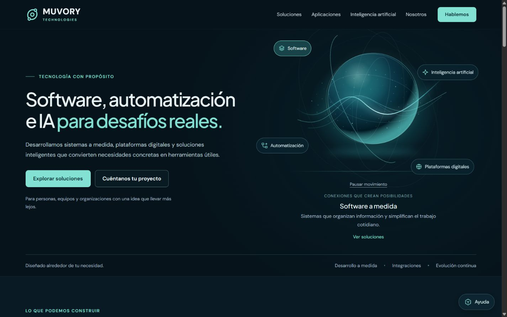

# MUVORY — rediseño para revisión visual

Rama: `redesign/premium-experience`. Base auditada: `main`, commit `46e929b`.

## Auditoría inicial

Se inspeccionaron todos los archivos de la aplicación y la versión pública en escritorio (1440 px) y móvil (390 px) antes de modificar el código.

- `App.jsx` reunía navegación, marca, esfera, cinco demos, aplicaciones, sectores, metodología, configurador y contacto.
- `CommercialAssistant.jsx` mantenía orientación guiada, reinicio y transferencia al formulario mediante `muvory:diagnostic`.
- `styles.css` acumulaba estilos de las versiones V2, V3 y V4, incluidos componentes ya ausentes, declaraciones repetidas del hero y escalados contradictorios a 1600/2400 px.
- Las secciones de aplicaciones y sectores repetían contenido. Los controles de las demos tenían texto de 9–11 px y bordes anidados.
- La esfera y el explorador ya ofrecían interacciones útiles; se conservaron. El asistente flotante ocupaba una parte de la visual móvil.
- La base compiló correctamente. No existían scripts de lint ni pruebas.

## Dirección visual

Se conserva el azul petróleo, el turquesa, la marca SVG y la esfera orbital. La portada usa un mensaje directo y una composición sin caja LAB. Plus Jakarta Sans identifica los títulos y DM Sans organiza textos e interfaces; las fuentes se solicitan con `display=swap` y tienen alternativas del sistema.

Principios estudiados mediante navegador: contención editorial en [Work & Co](https://work.co/), claridad de propuesta y proceso en [thoughtbot](https://thoughtbot.com/), demostración operativa en [Retool](https://retool.com/) y selector asociado a una escena en [Intercom](https://www.intercom.com/es-la). No se reutilizaron sus diseños, recursos ni afirmaciones comerciales.

La separación en componentes mantiene React, Vite, CSS y SVG; facilita revisar las interacciones y elimina la acumulación de versiones visuales en un solo archivo. No se añadieron dependencias de aplicación ni librerías 3D.

## Interacciones

- Órbita: cuatro botones accesibles, contenido contextual, rotaciones lentas y pausa manual.
- Software: vistas de productos/clientes/pedidos y estado por registro durante la sesión.
- Datos: tres vistas y barras seleccionables con valores de ejemplo accesibles.
- Automatización: tres pasos, confirmación local y reinicio.
- IA de servicios: modos de atención/clasificación/agenda y preguntas predefinidas.
- Web: prototipo ilustrativo con vistas escritorio/móvil.
- Aplicaciones por área: seis contextos, problemas, explicaciones, escenas distintas, flujo operativo y CTA contextual. Los anclajes antiguos `#casos` y `#sectores` siguen resolviendo a esta sección.
- Asistente visual: núcleo SVG abstracto, tres modos, respuesta simulada con procesamiento breve cancelable y pausa de animación.
- Asistente comercial: guía conservada en un diálogo nativo, cierre con Escape, foco contenido y regreso al lanzador; transferencia voluntaria al formulario.
- Configurador: propuesta por objetivo/área y transferencia con saltos de línea reales.
- Contacto: contexto editable, aviso cuando supera 3000 caracteres, decisión explícita para continuar sin contexto adicional y éxito solo tras respuesta HTTP satisfactoria.

## Responsive y accesibilidad

Contenedor limitado en pantallas amplias; tarjetas de igual altura por fila; rejilla 3+2 en escritorio, 2+2+1 en tablet y una columna en móvil. La selección orbital pasa a una rejilla táctil, los flujos pasan a disposición vertical y el menú móvil se expande dentro del encabezado. El lanzador de orientación usa una franja inferior en móvil con espacio al final de la página y safe-area.

Se mantuvieron encabezados semánticos, idioma español, SEO existente, etiquetas, foco visible, enlace para saltar contenido y estados anunciados. Todos los movimientos se desactivan mediante `prefers-reduced-motion`; esta condición se revisó en CSS. Las pausas manuales se comprobaron en navegador.

## Validación realizada

- `npm install`: instalación de las dependencias declaradas; 0 vulnerabilidades reportadas en ese momento. Se añadió lockfile para reproducibilidad.
- `npm run build`: correcto. Salida aproximada: CSS 45 kB / 10 kB gzip; JS 282 kB / 86 kB gzip. CSS de la base: 50.5 kB / 12 kB gzip.
- `npm test`: 5 pruebas de contrato HTTP del formulario: ausencia de endpoint, envío JSON confirmado, rechazo HTTP, fallo de red y propagación de timeout. No hacen solicitudes externas.
- `git diff --check`: correcto.
- No hay configuración de lint en el proyecto; no se añadió una dependencia solo para esta revisión.
- Navegador: cambio de registros y persistencia de estado, gráfico mediante teclado, flujo y reinicio, preguntas IA, cambio de vista web, seis áreas, simulación completa, cambio de modo durante procesamiento, configurador, transferencia del asistente, límite de contexto, cierre Escape y ciclo de foco.
- Formulario sin endpoint: mostró explícitamente que no se había enviado la solicitud. No se enviaron datos reales.
- Anchos comprobados: 360, 390, 430, 768, 1366, 1440, 1920 y 2560 px. Sin desbordamiento horizontal en la inspección del DOM.
- Inspección visual de escritorio y móvil; consola sin errores ni advertencias durante el recorrido final.
- GitHub Actions ejecuta `npm ci`, pruebas y build en el PR.

## Límites y pendientes

La recepción real requiere configurar y probar `VITE_CONTACT_ENDPOINT` en el entorno que corresponda. No se modificaron variables de producción, DNS ni correo. La respuesta HTTP confirma aceptación por el endpoint; la entrega final debe verificarse con el proveedor real cuando se habilite.

Todas las demos son simuladas. No hay API de IA conectada, credenciales ni datos de clientes. La revisión se realizó en el navegador Chromium disponible, con tamaños de viewport; no reemplaza pruebas en dispositivos físicos y otros motores.

La rama debe revisarse visualmente antes de fusionarse. La publicación de producción depende del flujo existente de GitHub y Cloudflare Pages.

## Capturas

[Recorrido completo desktop](review/muvory-desktop-completo.jpg) · [Recorrido completo móvil](review/muvory-movil-completo.jpg)
